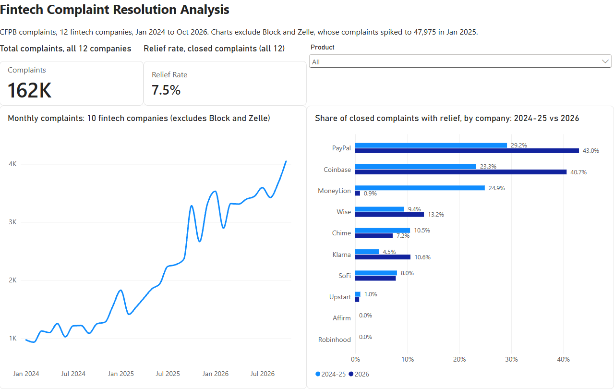

# Fintech Complaint Resolution Analysis



*Dashboard: "Fintech Complaint Resolution Analysis" (Power BI). Charts show the 10 fintechs other than Block and Zelle, November 2026 excluded.*

## Project summary

This project analyzes 162,698 consumer complaints about 12 fintech and digital banking companies from the CFPB Consumer Complaint Database, covering January 2024 to November 2026. It examines which issues dominate, how complaints are resolved, and whether patterns changed in 2026. The work is done end to end in MySQL, Python, Excel and Power BI, with results reconciled across tools.

## Business questions

1. What are the top complaint issues, and how did they change over time?
2. How are complaints resolved: closed with monetary relief, closed with non-monetary relief, or closed with explanation only?
3. Did patterns shift in 2026 (a possible structural break)?

## Data and scope

- Source: CFPB Consumer Complaint Database, full bulk file (https://files.consumerfinance.gov/ccdb/complaints.csv.zip), downloaded 2026-11-13. Details are in `docs/data_source.md`.
- Baseline period: 2024-01-01 to 2025-12-31. Comparison period: 2026-01-01 to the latest available date (2026-11-11).
- November 2026 is a partial month (318 complaints through November 11). It is excluded from the Power BI charts and the Excel "Other 10 trend" tab, while the Excel Monthly, Top issues and Relief Rate pivots include it.
- Companies: 12 fintechs, each with 1,000+ complaints since 2024: Block, Early Warning (Zelle), PayPal, Coinbase, MoneyLion, Wise, Chime, Klarna, SoFi, Upstart, Affirm and Robinhood.
- Products: 6 kept (money transfer or virtual currency, checking or savings, debt collection, payday or personal loan, credit card, prepaid card). Credit reporting was dropped because those complaints concern the bureaus, not the fintech.
- Funnel: 14,607,798 rows since 2024, then 185,119 for the selected companies, then 162,698 after the product filter (the final analysis table).
- Main series: the 10 companies other than Block and Zelle. Block and Zelle are shown separately because of the January 2025 surge.
- Judgment calls: Chime Inc. is treated as a variant of Chime Financial, and TransferWise Ltd is treated as Wise.

## Tools used

- MySQL 8: loading, cleaning and all analysis queries (`sql/`).
- Python: download and filter scripts, CSV export, and the analysis notebook (pandas, matplotlib, statsmodels). The notebook was run in Google Colab.
- Power BI: interactive dashboard.
- Excel: pivot-based workbook with a validation tab that reconciles 14 checks to the SQL results (all match).

## Key findings

Findings are for the 10 companies other than Block and Zelle unless noted.

1. **January 2025 outlier.** Block and Zelle had 47,975 complaints in January 2025, versus 1,828 for the other 10 companies. The month coincided with a public complaint campaign and CFPB enforcement news, so it is treated as an outlier.
2. **Volume growth.** Monthly complaints rose from 973 (January 2024) to 4,050 (October 2026). A trend model in the notebook found no statistically detectable 2026 jump above the existing trend (+297 per month, p = 0.21, 95% CI -164 to +758), though with 10 months of 2026 data the test has limited power.
3. **Issue mix.** Managing an account is the top issue in both periods (21.1% of complaints in 2024-25, 18.8% in 2026). Unauthorized transactions rose from 6.0% to 8.5%.
4. **Relief rates.** The share of closed complaints with relief rose from 14.4% to 18.6%, driven by PayPal (29.2% to 43.0%) and Coinbase (23.3% to 40.7%). MoneyLion fell from 24.9% to 0.9%. Affirm and Robinhood recorded no relief.

## Recommendations

These are areas a complaint or operations team could examine, not conclusions about cause.

- Review unauthorized-transaction complaints. Their share rose in 2026, so it is worth checking whether the increase reflects fraud controls, dispute handling or how complaints are categorized.
- Look into why relief rates differ so widely by company (PayPal and Coinbase above 40% in 2026, several others under 11%). Differences in outcome coding may explain part of the gap.
- Check how outcomes are recorded for companies reporting zero relief (Affirm, Robinhood). A true zero and a coding convention would call for different responses.
- Investigate the MoneyLion drop from 24.9% to 0.9% to see whether it reflects a process change or a reporting change.
- Monitor complaint volume by issue as shares of the total, and plan for campaign-driven spikes like January 2025 that can swamp normal trends.

## Limitations

- Complaints are unverified, and company responses are self-reported.
- There are no customer counts, so compare shares and rates rather than raw volume.
- Relief rates use closed complaints only, because 2026 includes in-progress cases.
- January 2025 is a Block and Zelle outlier. It coincided with a public complaint campaign and CFPB enforcement news, and the cause is not established from this data.
- November 2026 is partial (318 complaints through November 11), so any figure that includes it is incomplete for that month. See Data and scope for where it is included or excluded.
- The Excel Monthly, Top issues and Relief Rate pivots include the partial November 2026 data. The Other 10 trend tab and the Power BI charts exclude it. Power BI cards cover all 12 companies (7.5% relief), so they are not comparable to the Excel relief rate for the 10-company series. Because the dashboard excludes November, a few relief rates differ slightly from Excel and SQL (for example Wise 2026: 13.2% vs 13.0%).
- The structural-break test is a simple linear-trend model and cannot rule out a small shift. The cause of the 2026 changes is not established.

## How to reproduce

```
dashboard/   Power BI file and screenshot
docs/        data source log
excel/       workbook (fintech_complaint_workbook_v2.xlsx)
notebooks/   analysis notebook
scripts/     download, filter, export and MySQL helper scripts
sql/         numbered SQL files, run in order
```

Data files are stored outside the repository (default `C:\data\cfpb`, configurable with `DATA_DIR`). Credentials go in a git-ignored `.env` file with `MYSQL_USER` and `MYSQL_PASSWORD`.

1. Create a virtual environment and run `pip install -r requirements.txt`.
2. `python -I scripts/download.py` downloads the CFPB bulk file.
3. `python -I scripts/filter_by_date.py` keeps rows received on or after 2024-01-01.
4. Run `sql/01` and `sql/02` to create and load `complaints_raw` (`scripts/mysql_run.py` runs a file with credentials from `.env`; use `--local-infile` for the load).
5. Run `sql/03` to `sql/10` to profile the data, choose the companies and products, and build `fintech_complaints`, `fintech_core` and `fintech_clean`.
6. Run `sql/11` to `sql/21` for the analysis queries (volume, top issues, resolution outcomes, Jan 2025 breakdowns, relief rates, and the figures quoted in the key findings).
7. `python scripts/export_clean.py` exports `fintech_clean` to CSV.
8. Upload the CSV to Google Colab and run `notebooks/01_cfpb_analysis.ipynb`.
9. Open the Power BI and Excel files, which load the same CSV.

## Contact

Mohamed Omar | [LinkedIn](https://www.linkedin.com/in/visit-mohamedomar) | [GitHub](https://github.com/miomar36)
